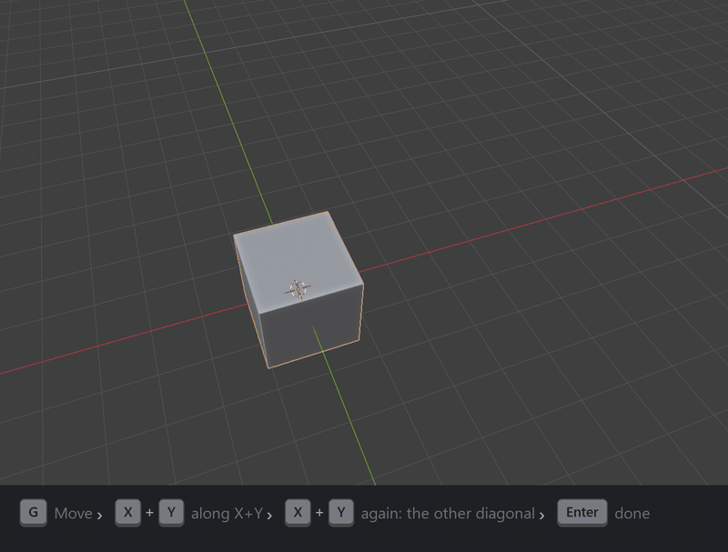
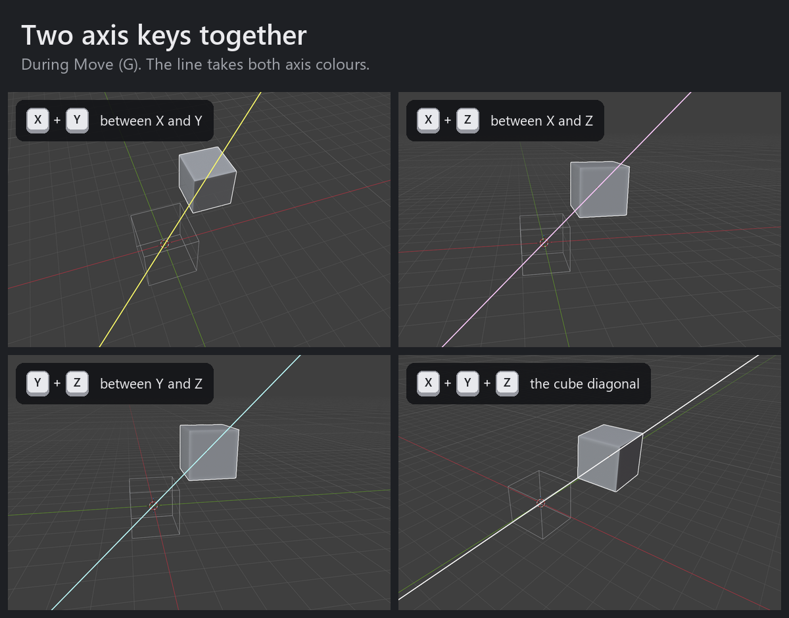
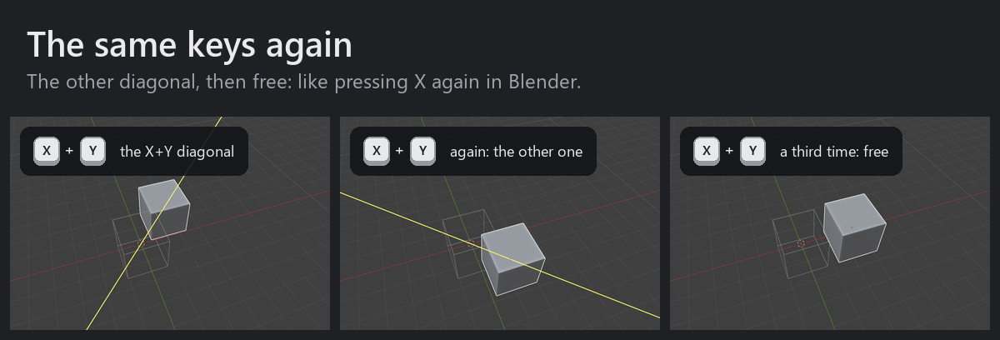
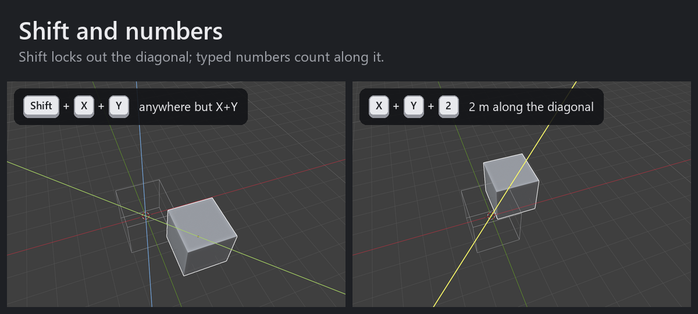

# Axis Chords

Move diagonally in Blender: press two axis keys together.



**G, then X+Y** moves along the diagonal between X and Y, the same way G, then X moves along X.
No new tool or panel: it is Blender's own Move, with one more way to lock it.
It works in Object Mode, in every Edit Mode (vertices, edges, faces, curves, armatures, lattices...) and in Pose Mode.

## How to use

Start a Move (G), then press two axis keys at the same time. The line shows the diagonal, in both axes' colours.



Press the same keys again for the other diagonal, and a third time to move freely, just as pressing X again
switches X from Global to Local and then off.



Shift works as it does for one axis (Shift+Z locks out Z): Shift + X + Y moves anywhere except along that
diagonal. Typed numbers count along the diagonal, like Blender's own axes.



| During Move (G) | Moves along |
|---|---|
| X+Y, X+Z, Y+Z | the diagonal between the two axes |
| X+Y+Z | the cube diagonal |
| the same keys again | the other diagonal; a third time, free |
| Shift + the keys | everything except that diagonal |
| one axis key after a chord | that axis, exactly as Blender does it (press again for Local) |
| middle mouse during a diagonal | Blender's own pick among X, Y and Z, as after G X |

- **Your keys:** the axis keys are the ones your Transform keymap has for X, Y and Z (and Shift for planes).
  With Y moved to C, the chord is X+C. Move itself can be on any key: the add-on follows it.
  An axis on a mouse button (Button 5 for X, say) chords too. Mouse buttons that send keys through
  the mouse's own software (G HUB, Logi Options+) are keys to Blender and work like the keyboard.
- **Together** means the second key goes down while the first is still held, or within 0.15 s of it
  (*Preferences > Add-ons > Axis Chords*).
- **Which diagonal:** the one closest to the way the mouse has moved since G. If it has not moved yet,
  the + + one; press the keys again for the other.
- **Numbers:** G, X+Y, 1, Enter moves 1 m along the diagonal (0.7071 on X and on Y). For the same amount
  on each axis, multiply by 1.4142 (two axes) or 1.7321 (X+Y+Z). Ctrl snaps in steps along the diagonal.
- **Orientation:** diagonals follow the orientation in the header (Global, Local, View, Cursor, your own).
  Normal in Edit Mode and Gimbal fall back to Global.

Everything else is Blender's: snapping, proportional editing, typed numbers and expressions, the header,
undo, Adjust Last Operation.

## Install

Blender 4.2 or later (tested on 5.2.3). Download `axis_chords-<version>.zip` from
[Releases](https://github.com/Z4RU5/axis-chords/releases), then in Blender
*Edit > Preferences > Get Extensions > ⌄ > Install from Disk*.

The add-on puts its Move on the same keys as Blender's Move (G by default) in each mode's keymap
(Object Mode, Mesh, Curve, Armature, Pose...), read when Blender starts. After changing Move's key,
restart Blender or turn the add-on off and on. To turn it off for one mode, search for "Axis Chords"
in *Preferences > Keymap*.

## How it works

Blender's Move is written in C, and a script cannot change it while it runs. So G starts Blender's own Move,
and a small watcher sits above it and sees each key first. Single axis keys pass straight through.
When two axis keys go down together, the watcher cancels that Move and starts Blender's Move again, locked to
a custom axis along the diagonal and offset so the selection keeps following the mouse. The restart takes
about 30 ms.

The custom axis is exactly 1 long, because Blender's axis lock assumes unit axes. Version 1.1 used a longer
axis (one unit on each axis), and in some views Blender's "looking straight along the axis" check then threw
the selection a billion metres away.

Python cannot cancel another operator directly. For a moment, the watcher adds a "Cancel on timer" item
to the Transform modal keymap of the active keymap preset and lets one timer event through; the Move cancels
itself, and the item is gone before the new Move starts. The preset is rebuilt at every start and never
saved, so your own keymap is not touched.

## Limits

- Only Move started with its key in the 3D Viewport; not the Move tool's gizmo, click-drag, Shift+D or E.
- If Move itself is on a mouse button in Blender's keymap, that Move stays plain Blender: with Release
  Confirms on (the default) it ends when the button is released, which a restarted Move cannot copy.
  Let the mouse software send a key for that button instead.
- Repeat Last (Shift+R) after a diagonal repeats along the first axis: Blender drops custom axes on
  Repeat Last. Adjust Last Operation (F9) keeps the diagonal.
- Keys pressed in the ~30 ms while the Move restarts are swallowed (except Esc and right-click, which cancel).
- During a diagonal, the header reads "global".

## Tests and pictures

`tests/run_ui_tests.py` runs 32 cases with simulated keys and mouse in a Blender window that opens behind
the others and ignores real input:

```
blender -b --factory-startup --python tests/make_scene.py
blender tests/test_scene.blend --factory-startup --enable-event-simulate --no-window-focus ^
        --window-geometry 100 100 1280 800 --python tests/run_ui_tests.py -- results.json [screenshots_dir]
```

The pictures above come from Blender's real UI the same way: `docs/visuals/capture.py` plays the keys,
`docs/visuals/compose.py` adds the keycaps and titles (Pillow and ffmpeg).

## License

GPL-3.0-or-later. Made by Ash & Pause.
